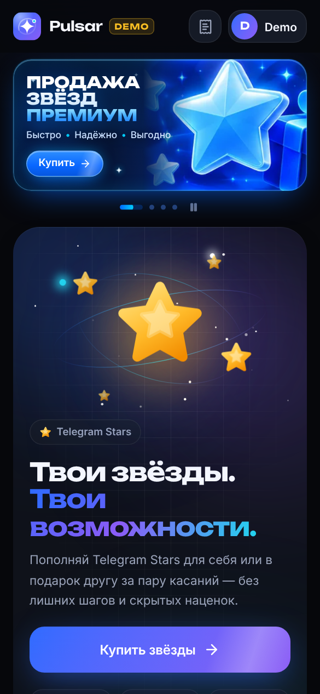
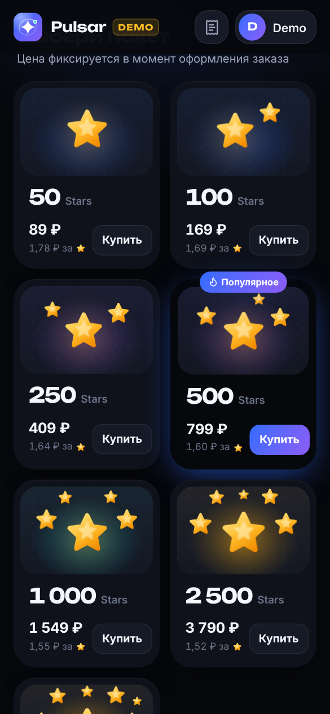
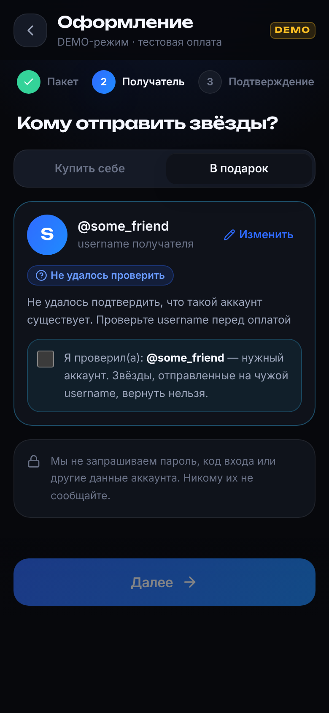
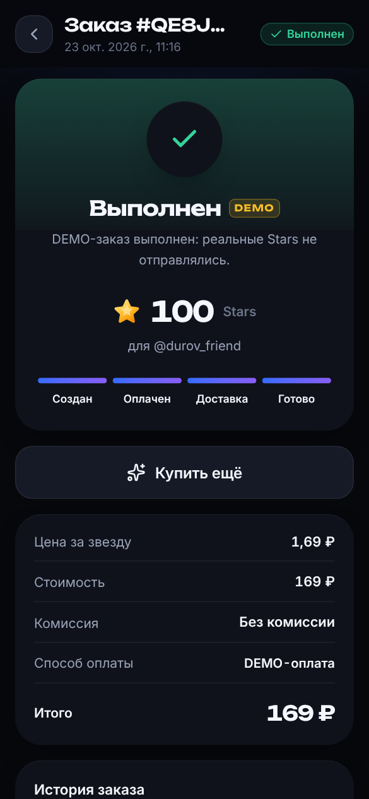
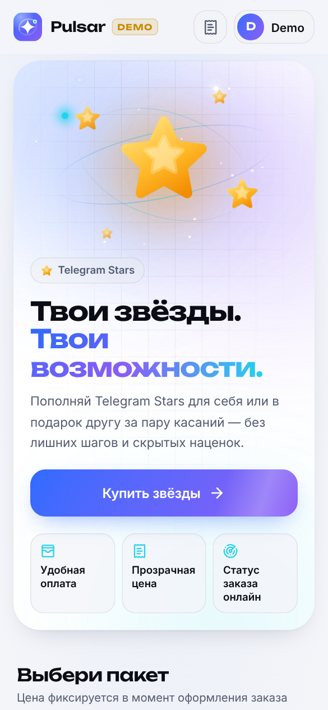
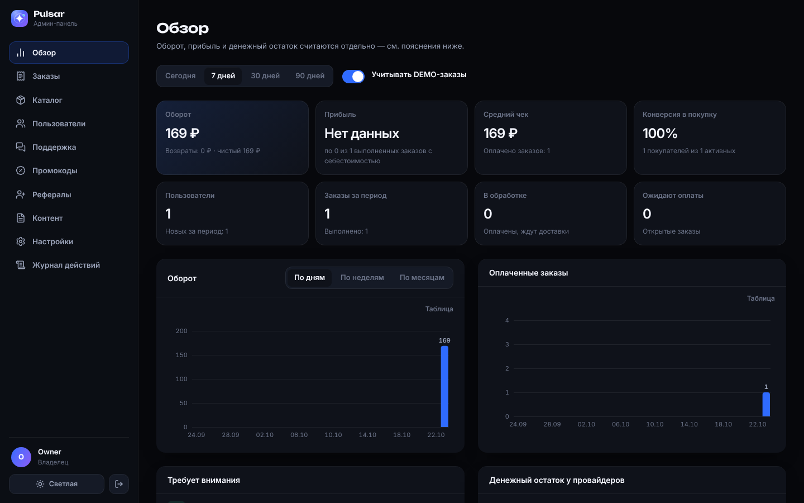

# Pulsar — магазин Telegram Stars

Telegram-бот, Mini App и админ-панель для продажи Telegram Stars на одном backend и одной базе данных. Визуальный стиль — игровая яркость и аккуратность премиальных продуктов: глубокий графитовый фон, электрический синий с фиолетовым, светящиеся звёзды, плавные микроанимации. Есть светлая тема.

> **Pulsar** — рабочее название. Название, слоган, логотип, цвета, тексты, FAQ и контакты меняются в админке (*Контент*), валюта — переменной `SHOP_CURRENCY`.

| Mini App | Каталог | Оформление | Статус заказа | Светлая тема |
| --- | --- | --- | --- | --- |
|  |  |  |  |  |



## Что внутри

**Mini App** (`webapp/`)
* Шапка с логотипом, аватаром и именем из Telegram, кнопкой истории заказов и индикатором загрузки.
* Главный баннер с анимированной композицией звёзд; учитывает настройку «уменьшить движение».
* Каталог пакетов: цена за звезду, метка «Популярное», выбранная администратором, отдельная карточка для своего количества.
* Секции «Как это работает», «Почему мы», «Оплата и возврат», последние заказы, FAQ и поддержка. Выдуманных отзывов и счётчиков нет.
* Покупка в три шага — пакет, получатель (себе или по @username с проверкой на сервере), подтверждение. На последнем шаге: итоговая сумма, скидка, бонусы, комиссия, способ оплаты, промокод и ссылки на условия.
* Статус заказа обновляется в реальном времени: шкала прогресса, лента событий, кнопки «Оплатить», «Я оплатил — проверить» и «Отменить».
* История заказов с фильтрами, профиль с бонусами и реферальной ссылкой, обращения в поддержку, тёмная, светлая и «как в Telegram» тема.
* Интеграция с Telegram: подпись `initData`, BackButton, haptic-отклик, safe area (включая fullscreen), подтверждение закрытия во время оплаты, запрос права писать в чат.
* Скелетоны, пустые состояния, понятные ошибки, собственные модальные окна, защита от двойных нажатий, ленивая загрузка экранов.

**Бот** (`backend/starshop/bot`, aiogram 3)
* `/start` с приветствием и клавиатурой: «✨ Открыть магазин», «✨ Купить Stars», «👤 Мой профиль», «🧾 Мои заказы», «💳 Способы оплаты», «🎁 Бонусы», «💬 Поддержка». Кнопка меню открывает Mini App.
* Профиль, последние заказы, способы оплаты, бонусы, обращение в поддержку прямо из чата. Ответы поддержки приходят в этот же чат.
* Уведомления на каждом шаге: ожидается оплата, оплата подтверждена, в обработке, доставлено, проблема, возврат — с кнопкой «Посмотреть заказ».
* `/admin` присылает одноразовую ссылку для входа в админку.

**Админ-панель** (`admin/`)
* Дашборд: оборот, возвраты, прибыль (только по заказам с себестоимостью), средний чек, конверсия, денежный остаток у провайдеров, проблемы, графики по дням, неделям и месяцам. Оборот не выдаётся за прибыль.
* Заказы: поиск по номеру, Telegram ID и @username, фильтры, детальный просмотр (платежи, доставка, журнал событий, вебхуки), безопасные действия, экспорт в CSV.
* Каталог: пакеты и своё количество, порядок, «популярное», включение и выключение, себестоимость с источником. Изменения сразу видны в Mini App.
* Пользователи (блокировки, заметки сотрудников, бонусы, рефералы), промокоды со статистикой, реферальная программа, контент, поддержка, настройки, администраторы и роли, журнал действий.

**Backend** (`backend/`, FastAPI + SQLAlchemy 2 + Alembic + PostgreSQL)
* Конечный автомат заказа: `created → pending_payment → paid → processing → completed`, а также `failed`, `refund_pending`, `refunded` и `cancelled`.
* Платёжный модуль с единым интерфейсом: DEMO и Crypto Pay (@CryptoBot). Подписи вебхуков проверяются, повторы отбрасываются, сумма и валюта сверяются, создание и подтверждение идемпотентны, возвраты и сверка выполняются в фоне.
* Доставка: DEMO, ручная через Fragment с подтверждением оператора, HTTP-адаптер поставщика с подписанным контрактом. Повторы безопасны, неясные ситуации уходят оператору.
* Уведомления через transactional outbox, промокоды, рефералы с журналом бонусов, поддержка, аудит, лимиты запросов, структурные логи с маскированием секретов.

## Быстрый старт (локально)

Нужны Python 3.12+, Node 22+, Docker (или локальные PostgreSQL 16 и Redis).

```bash
cd stars-shop
make infra                              # PostgreSQL + Redis в Docker
make install                            # venv + npm workspaces
cp backend/dev.env.example backend/.env
make migrate seed                       # схема БД + стартовый DEMO-каталог
make api      # терминал 1 → http://127.0.0.1:8000/api/docs
make worker   # терминал 2 → доставка, уведомления, сверка
make webapp   # терминал 3 → http://localhost:5173 (тестовый пользователь, Telegram не нужен)
make admin    # терминал 4 → http://localhost:5174/admin/
make admin-link                         # одноразовая ссылка входа в админку
```

В режиме разработки (`APP_ENV=development`, `DEV_AUTH_ENABLED=true`) backend подписывает тестовый `initData`, поэтому Mini App открывается в обычном браузере. В production этот эндпоинт отсутствует.

Бот (`make bot`) требует настоящий `BOT_TOKEN`. Mini App открывается из Telegram только по HTTPS: для локальной проверки в Telegram используйте туннель (например, `cloudflared`) и укажите его адрес в `PUBLIC_BASE_URL`.

## Тесты

```bash
make test           # backend (pytest, нужен PostgreSQL) + типы фронтенда + vitest
make lint
```

93 backend-теста на реальном PostgreSQL; схема создаётся миграциями Alembic, так что миграции проверяются тоже. Покрыты:
* создание заказа и идемпотентность;
* проверка подписи `initData` и Login Widget;
* подтверждение платежа, повторный и поддельный вебхук, расхождение суммы, валюты и ссылки, повторная и поздняя оплата;
* откат при сбое обработки вебхука;
* доставка: повторы, неясные ошибки, лимит попыток, ручная доставка, зависшие задачи, контракт HTTP-поставщика;
* возвраты, включая сбой провайдера и ручное подтверждение;
* доступ к чужим заказам и платежам;
* права ролей, CSRF и одноразовые ссылки входа в админку;
* промокоды (лимиты, резервирование, первый заказ), рефералы (самоприглашение, подарок пригласившему, отмена награды при возврате), бонусы;
* Crypto Pay на моках API, лимиты запросов, обработка 429/403 в отправке уведомлений, маскирование секретов в логах.

## Развёртывание

```bash
sudo ./deploy/scripts/install.sh   # Ubuntu VPS: Docker, .env, сборка, HTTPS, бэкапы
```

Подробно — в [docs/DEPLOY.md](docs/DEPLOY.md): домен и HTTPS, настройка @BotFather, переход в PRODUCTION, обновление (`update.sh`), бэкапы (`backup.sh`), восстановление (`restore.sh`), диагностика (`diagnose.sh`).

## DEMO и PRODUCTION

По умолчанию магазин работает в **DEMO**: оплата тестовая (подписанные события идут через настоящий конвейер вебхуков), Stars **не отправляются**, и это явно написано в интерфейсе, сообщениях бота и админке. Для production нужны:
1. реальный платёжный провайдер — [docs/PAYMENTS.md](docs/PAYMENTS.md), включая раздел о правилах Telegram для цифровых товаров;
2. реальная доставка — [docs/DELIVERY.md](docs/DELIVERY.md);
3. `ALLOW_PRODUCTION=true` и переключатель в админке. Сервер не даст включить PRODUCTION без настроенных реальных провайдеров.

## Что проверено и что нет

| Проверено | Как |
| --- | --- |
| Backend, бизнес-логика, безопасность | 93 автотеста на PostgreSQL (включая бота через диспетчер aiogram), ruff |
| Покупка от выбора пакета до «Выполнен» в DEMO | Браузер (Playwright) с dev-сервером и через Docker Compose стек с nginx и HTTPS |
| Docker-образы, compose, nginx (HTTP → HTTPS, CSP, SPA-маршруты), бэкап и восстановление | Локальный запуск стека (сертификат самоподписанный) |
| Сборка и типы Mini App и админки | `tsc` + `vite build` |

**Не проверено** (не было доступа): реальный Crypto Pay (только моки API), реальный поставщик Stars, выпуск сертификата Let's Encrypt на настоящем домене, работа бота с настоящим токеном в Telegram, открытие Mini App внутри клиентов Telegram. Перед продажами пройдите чек-лист из [docs/DEPLOY.md](docs/DEPLOY.md#6-переход-в-production).

## Документация

* [docs/ARCHITECTURE.md](docs/ARCHITECTURE.md) — модули, конечный автомат, сквозной сценарий, данные
* [docs/DEPLOY.md](docs/DEPLOY.md) — VPS, домен, HTTPS, обновление, бэкапы, восстановление, диагностика
* [docs/PAYMENTS.md](docs/PAYMENTS.md) — платёжный модуль, Crypto Pay, правила Telegram, как добавить провайдера
* [docs/DELIVERY.md](docs/DELIVERY.md) — способы доставки, ручная доставка через Fragment, контракт HTTP-поставщика
* [docs/SECURITY.md](docs/SECURITY.md) — модель угроз и меры защиты

## Структура

```
stars-shop/
├── backend/                 Python: API, бот, воркер (один пакет starshop)
│   ├── starshop/
│   │   ├── api/             REST /api/v1 (публичный и /admin), лимиты, ошибки
│   │   ├── bot/             aiogram 3
│   │   ├── database/        модели, сессии
│   │   ├── delivery/        способы доставки Stars
│   │   ├── notifications/   outbox и отправка в Telegram
│   │   ├── payments/        платёжные провайдеры и вебхуки
│   │   ├── services/        доменная логика
│   │   ├── shared/          деньги, подписи Telegram, маскирование
│   │   └── worker/          фоновые задачи
│   ├── migrations/          Alembic
│   └── tests/               pytest
├── webapp/                  Telegram Mini App (React + Vite + Tailwind + Motion)
├── admin/                   админ-панель (React + Vite + Tailwind)
├── shared/                  общие TS-типы, форматирование, логотип, дизайн-токены
├── deploy/                  Dockerfile'ы, nginx, скрипты эксплуатации
├── docs/                    документация и скриншоты
├── docker-compose.yml       production-стек
└── docker-compose.dev.yml   PostgreSQL и Redis для разработки
```

---

Telegram и Telegram Stars — товарные знаки Telegram. Проект — независимый сервис и не аффилирован с Telegram.
