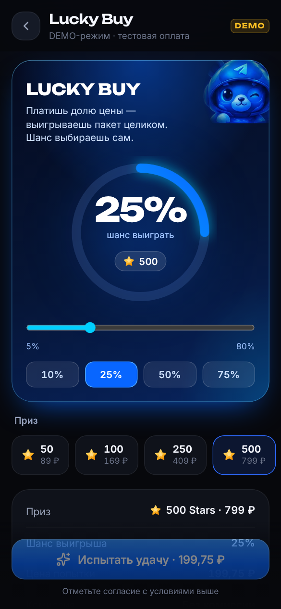

# Pulsar — магазин Telegram Stars

Telegram-бот, Mini App и админ-панель для продажи Telegram Stars на одном backend и одной базе данных. Визуальный стиль — игровая яркость и аккуратность премиальных продуктов: глубокий графитовый фон, электрический синий и голубой, светящиеся звёзды; зелёный — успех, красный — ошибка и отмена, плавные микроанимации. Есть светлая тема.

> **Pulsar** — рабочее название. Название, слоган, логотип, цвета, тексты, объявления и контакты меняются в админке (*Контент*), валюта — переменной `SHOP_CURRENCY`.

| Mini App | Каталог | Оформление | Статус заказа | Lucky Buy | Светлая тема |
| --- | --- | --- | --- | --- | --- |
|  |  |  |  |  |  |


## Что внутри

**Mini App** (`webapp/`)
* Главная по порядку: шапка → приветствие → большая карточка **🍀 Lucky Buy** («Испытай удачу за Stars», от 150 ⭐) → карточка «Купить Telegram Stars» с полем **своего количества** (цена считается сервером) → готовые пакеты → реферальная программа → последние заказы → нижняя навигация (Главная, Lucky, Заказы, Профиль). У каждого блока есть состояния загрузки, пустое и ошибка с повтором.
* Покупка себе или в подарок: username проверяется на сервере. Статусы честные — «Аккаунт найден» (с именем и фото), «Не удалось проверить» (нужно подтвердить username галочкой) или «Аккаунт не найден» (дальше не пустит). Чужие аватарки не подставляются.
* Lucky Buy оплачивается в **Telegram Stars**: покупатель выбирает приз и шанс, цена попытки — та же доля звёзд приза плюс сбор, не меньше минимальной ставки. Розыгрыш честный и проверяемый (commit-reveal). Подробнее — [docs/LUCKY_BUY.md](docs/LUCKY_BUY.md).
* **Telegram Premium** на 3, 6 и 12 месяцев — себе или в подарок, в Mini App и в боте (`/premium`). Цены задаются в каталоге админки.
* **Вывод реферальных бонусов звёздами**: пользователь создаёт заявку (бонусы замораживаются), администратор одобряет в разделе «Выводы» — и звёзды уходят на его аккаунт обычной доставкой. Отклонённая заявка или неуспешная доставка возвращают бонусы.
* Рефералы: ссылка `https://t.me/<бот>?start=ref_<код>`, кнопки «Поделиться» и «Копировать», приглашённые, активные, заработано, история бонусов.
* Стабильная загрузка: заставка в самом HTML (видна ещё до JavaScript), подсказка при долгом холодном старте сервера, ErrorBoundary вместо белого экрана, повтор загрузки экрана и однократная перезагрузка после нового деплоя, отчёты об ошибках клиента в админку (без initData и токенов).
* Статус заказа обновляется в реальном времени; история заказов с фильтрами, профиль, поддержка, условия покупки с правилами возврата. Тёмная, светлая и «как в Telegram» темы.
* Интеграция с Telegram: подпись `initData`, BackButton, haptic-отклик, safe area, нативное окно оплаты Stars (`openInvoice`), подтверждение закрытия во время оплаты.

**Бот** (`backend/starshop/bot`, aiogram 3)
* Меню: одна кнопка Web App «🌐 Открыть магазин» (синяя), «⭐️ Купить Stars» (зелёная), «👤 Профиль», «🧾 Мои заказы», «🎁 Рефералы», «💬 Поддержка» и кнопки, добавленные в админке. Цвета — это официальные стили кнопок Bot API (`primary`, `success`, `danger`); произвольных цветов Telegram не поддерживает.
* Покупка прямо в чате: пакет или своё количество → себе или другому → проверка получателя → сводка с ценой от сервера → способ оплаты → заказ. «Назад» и «Отмена» на каждом шаге, состояние диалога хранится отдельно для каждого пользователя (в базе или Redis), повторное нажатие не создаёт второй заказ.
* Оплата Telegram Stars (`pre_checkout_query` проверяет сумму, валюту, владельца и срок; `successful_payment` обрабатывается один раз).
* Премиум-эмодзи в сообщениях и на кнопках (Настройки → Эмодзи бота; ID эмодзи бот присылает администратору в ответ на отправленный эмодзи). Работают, если у владельца бота есть Telegram Premium; иначе бот сам отправит обычные эмодзи.
* Поддержка — чат с аккаунтом @username из «Контент → Поддержка» (если не задан — обращения внутри бота).
* `/ref` — реферальная ссылка и статистика; `/buy` — покупка; `/admin` — одноразовая ссылка входа в админку. Уведомления о каждом шаге заказа.

**Админ-панель** (`admin/`)
* Адрес: `https://<домен>/admin/`. Вход — командой `/admin` в боте (для Telegram ID из `ADMIN_TELEGRAM_IDS` или добавленных в панели администраторов) или через Telegram Login Widget. Остальным `/admin` показывает их Telegram ID и как получить доступ.
* Дашборд: оборот, возвраты, прибыль (только по заказам с себестоимостью), средний чек, конверсия, денежный остаток у провайдеров, проблемы, графики по дням, неделям и месяцам. Оборот не выдаётся за прибыль.
* Заказы: поиск по номеру, Telegram ID и @username, фильтры, детальный просмотр (платежи, доставка, журнал событий, вебхуки), безопасные действия, экспорт в CSV.
* Каталог: пакеты и своё количество, порядок, «популярное», включение и выключение, себестоимость с источником. Изменения сразу видны в Mini App.
* Пользователи (блокировки, заметки сотрудников, бонусы, рефералы), промокоды со статистикой, реферальная программа и журнал бонусов, контент и объявления, поддержка, настройки (Lucky Buy: цена, призы, шансы, лимиты, вкл/выкл), администраторы и роли, журнал действий.
* **Кнопки бота**: название, эмодзи, ряд и место, цвет, действие (сообщение, страница Mini App, ссылка https, раздел бота, пакет). Ссылки проверяются, изменения применяются без перезапуска и пишутся в журнал.
* **Ошибки**: сбои API, бота, фоновых задач и Mini App у покупателей, а также заказы с ошибкой доставки и неотправленные уведомления.

**Backend** (`backend/`, FastAPI + SQLAlchemy 2 + Alembic + PostgreSQL)
* Конечный автомат заказа: `created → pending_payment → paid → processing → completed`, а также `failed`, `refund_pending`, `refunded`, `cancelled` и `lost` (попытка Lucky Buy без выигрыша).
* Платёжный модуль с единым интерфейсом: DEMO, Crypto Pay (@CryptoBot) и Telegram Stars (XTR, `createInvoiceLink`, возвраты `refundStarPayment`). Подписи вебхуков проверяются, повторы отбрасываются, сумма и валюта сверяются, создание и подтверждение идемпотентны, возвраты и сверка выполняются в фоне.
* Доставка: DEMO, ручная через Fragment с подтверждением оператора, HTTP-адаптер поставщика с подписанным контрактом. Повторы безопасны, неясные ситуации уходят оператору.
* Уведомления через transactional outbox, промокоды, рефералы с журналом бонусов, поддержка, аудит, лимиты запросов, структурные логи с маскированием секретов.

## Быстрый старт (локально)

Нужны Python 3.12+, Node 22+, Docker (или локальные PostgreSQL 16 и Redis).

```bash
cd stars-shop
make infra                              # PostgreSQL + Redis в Docker
make install                            # venv + npm workspaces
cp backend/dev.env.example backend/.env
make migrate seed                       # схема БД + стартовый DEMO-каталог
make api      # терминал 1 → http://127.0.0.1:8000/api/docs
make worker   # терминал 2 → доставка, уведомления, сверка
make webapp   # терминал 3 → http://localhost:5173 (тестовый пользователь, Telegram не нужен)
make admin    # терминал 4 → http://localhost:5174/admin/
make admin-link                         # одноразовая ссылка входа в админку
```

В режиме разработки (`APP_ENV=development`, `DEV_AUTH_ENABLED=true`) backend подписывает тестовый `initData`, поэтому Mini App открывается в обычном браузере. В production этот эндпоинт отсутствует.

Бот (`make bot`) требует настоящий `BOT_TOKEN`. Mini App открывается из Telegram только по HTTPS: для локальной проверки в Telegram используйте туннель (например, `cloudflared`) и укажите его адрес в `PUBLIC_BASE_URL`.

## Тесты

```bash
make test           # backend (pytest, нужен PostgreSQL) + типы фронтенда + vitest
make lint
```

134 backend-теста на реальном PostgreSQL; схема создаётся миграциями Alembic, так что миграции проверяются тоже. Покрыты:
* создание заказа и идемпотентность;
* проверка подписи `initData` и Login Widget;
* подтверждение платежа, повторный и поддельный вебхук, расхождение суммы, валюты и ссылки, повторная и поздняя оплата;
* откат при сбое обработки вебхука;
* доставка: повторы, неясные ошибки, лимит попыток, ручная доставка, зависшие задачи, контракт HTTP-поставщика;
* возвраты, включая сбой провайдера и ручное подтверждение;
* доступ к чужим заказам и платежам;
* права ролей, CSRF и одноразовые ссылки входа в админку;
* промокоды (лимиты, резервирование, первый заказ), рефералы (самоприглашение, подарок пригласившему, отмена награды при возврате), бонусы;
* Crypto Pay на моках API, лимиты запросов, обработка 429/403 в отправке уведомлений, маскирование секретов в логах;
* Lucky Buy: цена от шанса, доступность по режиму, выигрыш и проигрыш, однократный розыгрыш при повторных и поздних оплатах, раскрытие и проверка сида, лимиты, возврат только владельцем, статистика;
* покупка в боте (пакет себе, своё количество в подарок с проверками, отмена, устаревшие кнопки), оплата Lucky Buy звёздами через `pre_checkout_query` и повторный `successful_payment`, хранение диалогов;
* проверка получателя (найден, не найден, не подтверждён), подписанные ссылки на аватар, конструктор кнопок бота (опасные ссылки, права, аудит), журнал ошибок без секретов, обзор рефералов;
* serverless-режим для Vercel: быстрый старт без Alembic, когда база уже актуальна, и без загрузки aiogram для страниц магазина; значения по умолчанию, адреса баз Neon и Supabase, подготовка новой базы (миграции и каталог ровно один раз при одновременном старте), покупка без воркера, демо-аккаунты из браузера, вебхук бота.

## Развёртывание

```bash
sudo ./deploy/scripts/install.sh   # Ubuntu VPS: Docker, .env, сборка, HTTPS, бэкапы
```

Подробно — в [docs/DEPLOY.md](docs/DEPLOY.md): домен и HTTPS, настройка @BotFather, переход в PRODUCTION, обновление (`update.sh`), бэкапы (`backup.sh`), восстановление (`restore.sh`), диагностика (`diagnose.sh`).

DEMO можно выложить на Vercel. Там работают Mini App, админка, API и бот на вебхуке, база — Neon, демо открывается в обычном браузере. Как это сделать — в [docs/VERCEL.md](docs/VERCEL.md).

## DEMO и PRODUCTION

По умолчанию магазин работает в **DEMO**: оплата тестовая (подписанные события идут через настоящий конвейер вебхуков), Stars **не отправляются**, и это явно написано в интерфейсе, сообщениях бота и админке. Для production нужны:
1. реальный платёжный провайдер — [docs/PAYMENTS.md](docs/PAYMENTS.md), включая раздел о правилах Telegram для цифровых товаров;
2. реальная доставка — [docs/DELIVERY.md](docs/DELIVERY.md);
3. `ALLOW_PRODUCTION=true` и переключатель в админке. Сервер не даст включить PRODUCTION без настроенных реальных провайдеров.

## Что проверено и что нет

| Проверено | Как |
| --- | --- |
| Backend, бизнес-логика, безопасность | 134 автотеста на PostgreSQL (включая бота через диспетчер aiogram), ruff |
| Покупка от выбора пакета до «Выполнен» в DEMO | Браузер (Playwright) с dev-сервером и через Docker Compose стек с nginx и HTTPS |
| Docker-образы, compose, nginx (HTTP → HTTPS, CSP, SPA-маршруты), бэкап и восстановление | Локальный запуск стека (сертификат самоподписанный) |
| Сборка и типы Mini App и админки | `tsc` + `vite build` |
| Сборка для Vercel и работа функции | `vercel build` и запуск собранной функции через рантайм Vercel локально, покупка в браузере на новой базе |

**Не проверено**: реальная оплата Telegram Stars (только моки Bot API — настоящие звёзды намеренно не списывались), реальный поставщик Stars (Fragment API), реальный Crypto Pay, выпуск сертификата Let's Encrypt на своём домене, нажатия в клиентах Telegram на телефоне. DEMO развёрнут на Vercel с базой Neon, вебхук бота зарегистрирован с настоящим токеном. Перед продажами пройдите чек-лист из [docs/DEPLOY.md](docs/DEPLOY.md#6-переход-в-production).

## Документация

* [docs/ARCHITECTURE.md](docs/ARCHITECTURE.md) — модули, конечный автомат, сквозной сценарий, данные
* [docs/DEPLOY.md](docs/DEPLOY.md) — VPS, домен, HTTPS, обновление, бэкапы, восстановление, диагностика
* [docs/VERCEL.md](docs/VERCEL.md) — DEMO на Vercel: запуск, переменные, демо-аккаунты, бот на вебхуке, ограничения
* [docs/PAYMENTS.md](docs/PAYMENTS.md) — платёжный модуль, Crypto Pay, правила Telegram, как добавить провайдера
* [docs/DELIVERY.md](docs/DELIVERY.md) — способы доставки, ручная доставка через Fragment, контракт HTTP-поставщика
* [docs/LUCKY_BUY.md](docs/LUCKY_BUY.md) — Lucky Buy: механика, настройки, проверка честности розыгрыша, юридическое предупреждение
* [docs/SECURITY.md](docs/SECURITY.md) — модель угроз и меры защиты

## Структура

```
stars-shop/
├── backend/                 Python: API, бот, воркер (один пакет starshop)
│   ├── starshop/
│   │   ├── api/             REST /api/v1 (публичный и /admin), лимиты, ошибки
│   │   ├── bot/             aiogram 3
│   │   ├── database/        модели, сессии
│   │   ├── delivery/        способы доставки Stars
│   │   ├── notifications/   outbox и отправка в Telegram
│   │   ├── payments/        платёжные провайдеры и вебхуки
│   │   ├── services/        доменная логика
│   │   ├── shared/          деньги, подписи Telegram, маскирование
│   │   └── worker/          фоновые задачи
│   ├── migrations/          Alembic
│   └── tests/               pytest
├── api/                     функция Vercel (весь API из backend/)
├── webapp/                  Telegram Mini App (React + Vite + Tailwind + Motion)
├── admin/                   админ-панель (React + Vite + Tailwind)
├── shared/                  общие TS-типы, форматирование, логотип, дизайн-токены
├── deploy/                  Dockerfile'ы, nginx, скрипты эксплуатации
├── docs/                    документация и скриншоты
├── docker-compose.yml       production-стек
├── docker-compose.dev.yml   PostgreSQL и Redis для разработки
└── vercel.json              сборка и маршруты для Vercel
```

---

Telegram и Telegram Stars — товарные знаки Telegram. Проект — независимый сервис и не аффилирован с Telegram.
